# Architecture Documentation — Codebase Graph Intelligence Platform

## Overview
The **Codebase Graph Intelligence Platform** is a production-grade enterprise code intelligence system featuring Graph RAG, deep multi-language AST parsing, vector search, architecture discovery, static quality and security analysis, and automated pull request (PR) impact analysis.

```mermaid
flowchart TD
    subgraph Ingestion Pipeline
        A[Repository Ingestion] --> B[Multi-Language AST Parser]
        B --> C[Symbol & Relationship Extraction]
        C --> D[(Neo4j Knowledge Graph)]
        C --> E[Symbol-Aware Chunks]
        E --> F[Hugging Face BGE Embeddings]
        F --> G[(Qdrant Vector Database)]
    end

    subgraph Core Intelligence Features
        H[Codebase Query - Graph RAG]
        I[Impact Analysis]
        J[API Flow Analysis]
        K[Architecture Intelligence & Visualization]
        L[Code Quality & Security Analysis]
        M[Pull Request Analysis]
    end

    subgraph Graph RAG Query Flow
        N[User Query] --> O[Query Analyzer & Intent Classifier]
        O --> P[Entity Resolution]
        P --> Q[Neo4j Graph Traversal]
        P --> R[Qdrant Semantic Retrieval]
        Q & R --> S[Reciprocal Rank Fusion]
        S --> T[Bounded Subgraph Context]
        T --> U[LLM Reasoning & Synthesis]
        U --> V[Grounded Answer Validation]
    end

    subgraph Async PR Automation Architecture
        W[GitHub / GitLab Webhooks] --> X[X-Hub Signature Authentication]
        X --> Y[Action Policy Filter]
        Y --> Z[Delivery Deduplication & Idempotency]
        Z --> AA[(Redis Queue)]
        AA --> AB[ARQ Async Worker Process]
        AB --> AC[Internal Diff Engine - app/diff]
        AC --> AD[Code Impact Analysis Service]
        AD --> AE[Evidence-Based PR Review Comment]
    end
```

---

## The Six Primary Platform Features

The platform provides exactly six user-facing features across its API and frontend interface:

1. **Codebase Query (Graph RAG)**: Natural-language question answering backed by hybrid graph-and-vector retrieval, bounded subgraph context construction, and grounded OpenAI LLM synthesis.
2. **Impact Analysis**: Blast-radius dependency exploration discovering upstream and downstream callers, affected interfaces, and call chains up to configurable depths with actionable developer explanations.
3. **API Flow Analysis**: Cross-language API route extraction and matching connecting client fetch/axios/HTTP calls to backend controllers and endpoint definitions.
4. **Pull Request Analysis (Evidence-Based Review)**: Automated, asynchronous pull-request analysis powered by the internal diff engine, detecting signature drifts, modified symbols, affected downstream consumers, and producing actionable review findings.
5. **Architecture Intelligence & Visualization (NEW)**: High-level architectural discovery extracting project modules, directory structures, architectural layers (Presentation, Business Logic, Persistence, Infrastructure), entry points, and interactive Cytoscape module dependency graphs.
6. **Code Quality & Security Analysis (NEW)**: Static analysis detecting code maintainability smells (high cyclomatic complexity, excessive parameters, mutable default arguments, wildcard imports, silent exception suppression) and security risks (hardcoded API keys, tokens, SQL injection, insecure command execution). Secret tokens are automatically redacted.

---

## Architectural Subsystems

### 1. Ingestion & Multi-Language Parsing
- **Parsers**: Python AST, Tree-sitter for Go, Java, JavaScript, and TypeScript via `ParserFactory`.
- **Entities Extracted**: Classes, Methods, Functions, Interfaces, Call Relations, Imports, Inheritance.
- **Chunks**: Symbol-aware line-bounded code blocks tied to exact symbol IDs.

### 2. Dual-Database Storage Architecture
- **Neo4j (Knowledge Graph)**: Stores nodes (`File`, `Class`, `Function`, `Module`, `Interface`, `ApiEndpoint`, `ApiClientCall`) and edges (`CALLS`, `INHERITS`, `IMPORTS`, `DEFINES`, `CALLS_ENDPOINT`).
- **Qdrant (Vector Database)**: Stores 384-dimensional `bge-small-en-v1.5` embeddings for semantic chunk retrieval.

### 3. Graph RAG Hybrid Retrieval
- **Query Intent Classifier**: Identifies structural queries vs broad semantic queries.
- **Reciprocal Rank Fusion (RRF)**: Merges graph traversal candidate ranks with vector similarity scores ($k=60$).
- **LangGraph Workflow**: Orchestrates query analysis, retrieval, context fusion, LLM synthesis, and validation.

### 4. Architecture Intelligence Subsystem (`app/analysis/architecture_service.py`)
- Analyzes repository topology from Neo4j (or AST filesystem fallback when Neo4j is offline).
- Classifies modules into 4 architectural layers:
  1. *Presentation / API Layer*: Controllers, routes, webhooks, UI handlers.
  2. *Business Logic & Services*: Core intelligence, workflows, diff analyzers, PR services.
  3. *Persistence & Storage*: Database drivers, graph stores, vector stores.
  4. *Infrastructure & Core Utilities*: Config, parsing factories, utilities.
- Identifies system entry points (`main.py`, server entry points, CLI roots).
- Generates grounded architectural summaries without fabricating absent modules.

### 5. Code Quality & Security Scanner (`app/analysis/quality_security_service.py`)
- **Credential & Secret Scanner**: Regex rules for OpenAI keys, AWS access keys, GitHub personal access tokens, private keys, and hardcoded passwords.
- **Secret Redaction**: Every detected token is sanitized with cryptographic masking (e.g., `sk-proj-****[REDACTED]****a1b2`). Raw tokens are never logged or returned.
- **Security Vulnerability Patterns**: Detects dynamic code execution (`eval`, `exec`), command injection (`shell=True`, `os.system`), SQL injection patterns, and unverified SSL connections (`verify=False`).
- **AST Quality Smell Detection**: Analyzes Python ASTs for cyclomatic complexity > 10, function length > 50 lines, parameter counts > 6, mutable default arguments, wildcard imports (`from ... import *`), and bare/silent exception suppression (`except: pass`).

### 6. Internal Diff Subsystem (`app/diff/`)
- Retained to power Pull Request Analysis.
- Excluded from standalone user-facing navigation and public OpenAPI schema (`include_in_schema=False`).
- Components include:
  - `StructuralDiffAnalyzer`: High-level diff orchestrator.
  - `GitDiffService`: Deterministic Git commit comparison.
  - `SymbolDiffAnalyzer`: Detection of added, modified, and removed symbols.
  - `SignatureDiffAnalyzer`: Detection of breaking signature, parameter, and return type drifts.
  - `APIDiffAnalyzer`: API route changes and endpoint contract evolution.

### 7. Async PR Automation & Worker Queue
- **Webhook Gateway**: Fast ingestion returning `HTTP 202 Accepted` in under 50 ms.
- **Redis & ARQ Workers**: Multi-worker background architecture with exponential retry, failure classification (`transient` vs `permanent`), dead-letter queue, and delivery deduplication.

---

## UI/UX Design System: Midnight Graphite + Electric Blue

The user interface follows a professional developer intelligence console aesthetic:
- **Surface Palette**:
  - Top Navigation Header: `#0C1422`
  - Left Primary Sidebar: `#131E30`
  - Right Context Inspector: `#101A2A`
  - Main Workspace Canvas: `#0A1120`
  - Surface Cards & Panels: `#162338`
  - Elevated Cards & Modals: `#1D2C43`
  - Borders: `#293A52`
- **Accent & Interactive Palette**:
  - Primary Electric Blue: `#4F8CFF`
  - Hover Blue: `#3478F6`
  - Active Blue: `#1D3B70`
- **Semantic Palette**:
  - Success: `#2DD4BF`
  - AI / Reasoning: `#A78BFA`
  - Information: `#38BDF8`
  - Warning: `#FBBF24`
  - Critical / Error: `#FB7185`
- **Graph Node Colors**:
  - File: `#60A5FA`
  - Class: `#C084FC`
  - Function / Method: `#34D399`
  - API Endpoint: `#FBBF24`
  - API Client Call: `#F472B6`
  - API Contract: `#22D3EE`

